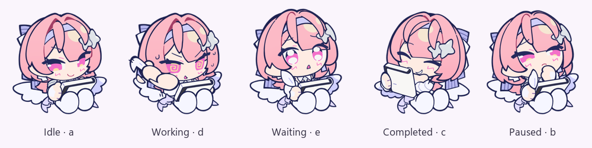

# ZCode Pet

原生 C++ / Win32 桌宠，只读观察已经运行的 ZCode 会话。角色使用 Spine 骨骼动画，无需修改 ZCode 安装包、源码、配置或启用调试端口，也不启动新 agent。

[下载最新版本](https://github.com/Nakiha/Zcode-Pet/releases/latest) · [运行行为](spec/behavior.md) · [性能说明](docs/performance.md)

## 运行

Windows 11 x64，目标最低系统版本 26200.8875。解压便携包，保持 `assets` 与 `ZCodePet.exe` 同目录，双击 EXE。完整的 `assets/spine` 为必需资源；资源不可用时明确报错。

无需 WinUI、Windows App SDK、WebView2、Python、Node 或额外 VC 运行库。设置保存在 `%LOCALAPPDATA%/ZCodePet/settings.ini`。

## 交互与设置

- 悬停宠物展开 Sessions，离开宠物和面板后自动收起；右键可固定。Esc 或手动收起取消固定。
- 拖动宠物移动，矩形交互区稳定，触边后可直接向内拉回。实际开始拖动时播放一次原生回弹，普通点击不触发，鼠标移动不反复重播。
- 滚轮缩放宠物；面板内滚轮浏览最近最多 40 个未归档会话。
- 右键 → **会话面板 → 显示会话数量**：最多同时显示 1–10 行，默认 3 行，可恢复默认；调整立即生效并保存，重启保留。实际行数受列表长度和屏幕工作区限制。调整数量回到列表顶部。
- 右键工具栏可调整宠物大小、面板缩放、文字显示、背景材质，或查看素材署名与许可。
- 背景支持实时亚克力、仅取壁纸的 Mica、纯色；系统不支持透明材质时使用实色。浮层共用 DPI、屏幕边距和避让规则。
- 完成/等待提醒保留到手动关闭；开始新一轮时清理对应旧提醒。多个会话各自保留提醒，关闭后其余气泡平滑补位。悬停显示左上角关闭按钮，正文、行和按钮均有 hover / press 反馈。
- 点击会话行或提醒正文，通过 Windows UI Automation 打开 ZCode 中唯一匹配的已有会话，不发送消息。重名、折叠、筛选或无法聚焦时提示失败，兼容完整标题后附时间的名称，并在同项目已知标题间做最长前缀消歧；不接受任意后缀或坐标猜选。[导航限制](spec/session-navigation.md)
- EXE、窗口和托盘均内嵌多尺寸图标，支持 DPI 缩放与 Explorer 重启恢复。

## Spine 动画与渲染

使用 Spine 4.2.43 导出及固定版本的官方 spine-cpp 4.2，来源见 `third_party/spine-cpp/UPSTREAM.txt`。动作以 AnimationState 混合衔接，默认 0.22 秒，映射与帧率可在 `assets/spine/animations.ini` 调整。

| 状态 | 动画 |
|---|---|
| 空闲 | a |
| 工作中 | d |
| 悬停 / 等待回答 | e |
| 完成 | c |
| 错误 / 中断 | b |
| 拖拽回弹 | a_win（工作中 d_win），仅开头约 1.07 秒 |

默认角色使用小画布软件三角形渲染、双线性采样及复用的 DC/DIB。普通角色 30 FPS，动作混合和回弹期间 60 FPS；回弹结束后接上最新状态并恢复普通帧率。可用 `--spine-gpu` 对照原生 D3D11 后端，硬件失败时可恢复到 Spine 软件路径。Windows 系统 GDI+ 仅用于提醒关闭按钮绘制。

UI 使用 Windows Composition 保留式图层：静态面板内容只在变化时更新，加载弧线和标题扫光由系统合成器播放；UI 动效随显示器刷新率，120 Hz 对应约 8.33 ms。显示输出不活跃时有节拍保护，避免驱动立即返回垂直同步等待造成空转。交互可立即打断角色的低频等待。[测量条件与结果](docs/performance.md)



## 状态观察范围

每两秒只读查询 `~/.zcode/v2/tasks-index.sqlite` 及当前回合的日志证据，包含已提交 WAL 记录，不读取凭据。完成提醒使用索引中的会话名称。忽略早于当前 ZCode 主进程启动的活动事件，按 turnId 排除旧回合结束事件；不因任务运行过久而自动降级状态。

状态持续时间来自可验证的事件起点，明确区分当前状态与上次持久化结果；未知起点显示下界标记。完成动作按新事件排队，播完后恢复当前等待/工作/空闲状态。观察器依赖 ZCode 的数据库和日志结构；版本变化、日志缺失或数据库错误会影响可观察范围。

## 构建与验证

```powershell
cmake -S . -B build -A x64
cmake --build build --config Release
ctest --test-dir build -C Release --output-on-failure
```

需要 Visual Studio C++ 和 Windows SDK（本机 10.0.26100）。构建时刷新专属输出目录内的 assets，避免旧素材残留。16 项 CTest 覆盖观察器、展示、字形、边界/避让、浮层和交互动效、导航、提醒、保留式合成、栅格边界、Spine 状态/资源生命周期和时钟节拍。

- `--probe`：只读检查运行实例，写 EXE 旁的 `probe.txt`，包含实际后端、错误计数、帧率需求、托盘注册及会话行数，不输出会话内容。
- `--panel` / `--quit`：展开面板启动 / 正常退出已运行实例。
- `--demo --preview --panel`：本地合成事件验证多提醒、重命名、回弹之外的状态切换及新轮清理，不向 ZCode 发任务。
- `--spine-render-test --software` / `--spine-render-test`：生成软件/硬件参考 PNG，含拖拽序列；正常渲染无 GPU 回读。
- `scripts/profile-gpu.ps1 -Exe .\build\Release\ZCodePet.exe -OutputDirectory .\build\gpu-profile`：采集固定场景的 GPU 引擎、CPU、显存和绘制计数，结束后恢复正常实例。支持 `pet`、`pet-frozen`、`running`、`running-frozen`、`running-spine-gpu`、`running-legacy` 及材质/动效诊断后缀。脚本的整卡快照需要 NVIDIA `nvidia-smi`。

尚未在独立最低系统版本虚拟机上验收，也不通过实际发送任务制造完成或权限事件。

## 许可与素材

Spine 角色资源由用户提供的 `Q版蕾米.zip` 导出，原包没有单独美术许可，本项目不另行授予角色使用权。来源见 `assets/spine/ATTRIBUTION.txt`。

**Spine runtime 不是 MIT 或宽松许可证。** 使用与分发须遵守随附的完整官方协议；若无适用 Spine Editor 许可覆盖，协议要求每个产品使用者自行取得 Spine Editor 许可。详见 [官方运行时许可](https://esotericsoftware.com/spine-runtimes-license)、`third_party/spine-cpp/LICENSE` 和 `assets/spine/SPINE-RUNTIME-LICENSE.txt`。

JSON 解析使用 nlohmann/json 3.11.3（MIT），完整许可位于 `third_party/json.LICENSE`。其余系统图形、数据库与 UI Automation 组件来自 Windows。

灰度正文与扫光遮罩使用固定物理像素原点，并关闭 DirectWrite 的二次基线吸附，减少合成表面重绘时的基线跳变。低分辨率屏幕的实际视觉效果仍需设备复核。

日志缺少当前 turn 证据时，只读 cli/db/db.sqlite 的最新 assistant 消息作为推断运行态兜底：检查 finish、完成时间及该消息中未结束的 running part，过滤当前 ZCode 进程启动前的遗留证据和明确已结束回合。数据库不可用不覆盖日志。推断无法保证识别所有异常中断。导航分别提示“找不到条目”和“条目离屏”；虚拟列表未挂载的条目只能归为找不到。

0.2.4 起，现代项目导航按任务的 workspace/session 身份取得 project_id，再读取 projects.name 作为侧栏显示名，支持项目重命名及工作目录与项目名不一致。项目删除、关联缺失或显示名有歧义时拒绝猜选；确认旧数据库不含项目模型时才使用旧目录标签。

运行和等待中的已有会话保持各自分组内的顺序，不随数据库 updated_at 的交替更新反复换位；新进入的会话插入一次，真实状态变化时再调整分组。
