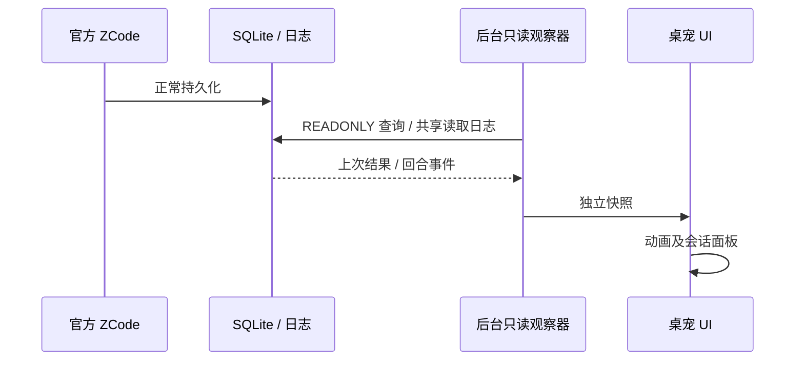

# 独立桌宠首版

## 轻量交互反馈

- Session 行使用内缩 4 DIP、上下 3 DIP 的圆角浅紫高亮，hover 透明度 7.5%，press 23%；提醒正文在原有圆角内叠加 hover 5.5%、press 20% 的同色薄层。高亮位于文字与状态徽章下方，不新增边框、外圈、缩放或位移。
- 工具栏沿用原有按钮轮廓：普通 hover 9%、press 23%，选中常态 18%、选中 hover 21%、选中 press 32%；选中图标颜色同步平滑过渡。静态数值项不绘制交互背景。
- 颜色按 CSS ease-out `cubic-bezier(0, 0, 0.58, 1)` 插值：hover 进入 140 ms、离开 160 ms；按下 40 ms、抬起 120 ms。短按且鼠标仍在原项时，按下反馈从按下起至少保留 85 ms，再开始回退；仅延后视觉回退，点击动作立即执行，移出则取消保留。中途反向从当时实际颜色续接，快速移过多行时各自行渐隐，不跳变或追着鼠标移动整块背景。
- Session 视觉反馈按 workspace/session 身份关联，轮询排序不把按下态转给其他行；滚动、隐藏、捕获丢失及移出窗口会重新核对命中。按下拖出时撤销 press，回到同一项可恢复；在其他项抬起不导航。提醒关闭钮保留独立交互。
- 三类反馈共用现有 QPC / DXGI 垂直同步时钟，由统一交互动效所有者汇总帧需求，不覆盖加载动画或浮层进退场的帧需求。120 Hz 下按刷新节拍绘制，隐藏表面停止交互帧，末帧归位后休眠；不增加固定 60 Hz/16 ms 定时器。

- 宠物的整个窗口矩形为稳定交互区，包括 GIF 透明处；悬停、拖动、滚轮及右键不依赖当前动画帧的轮廓。分层窗口的完全透明像素使用最低非零 alpha（1/255）保持系统命中，视觉仍透明，不添加可见背景框；每帧输出均保持该规则。

## 会话导航（当前 UIA 规则）

- 用户点击会话行或完成/等待提醒正文时，通过 Windows 原生 UI Automation 定位并打开已有 ZCode 会话；不发送消息、不创建任务、不写 ZCode 数据或配置。后台观察不触发导航或抢焦点。
- 两个入口共享导航服务；鼠标按下时捕获 workspace/session 身份，抬起时要求仍命中同一行，避免轮询排序、滚动或拖出导致打开其他会话。提醒独立持有事件身份，点击时按最新观察更新标题；正文跳转不关闭提醒，左上角叉号只关闭。
- 按当前完整标题及项目路径末段匹配 AX 列表项和项目分组，只允许唯一候选。不同身份但同项目名/标题、会话已离开观察列表、空标题、未显示、折叠或过滤时明确失败，不猜测、不按模糊标题或固定坐标点击。演示数据禁止导航。
- UIA 在独立 MTA 线程运行，单次仅一项导航。优先使用 Invoke 或 Legacy 默认动作；不支持时仅在窗口前台且条目实际获得焦点后发送 Enter。操作前重新检查标题/项目和前台窗口，失败不继续发送键盘输入。恢复/激活只发生于用户点击。
- 导航期间显示轻量进度，失败使用托盘提示，不覆盖持久提醒及其队列。诊断仅输出状态枚举、匹配数量和动作种类，不记录标题、内容或身份。关闭程序时停止接收请求并等待导航线程释放 COM。
- 测试覆盖行命中/滚动、身份捕获、空标题、路径末段、重名歧义和通知身份更新；Windows 验收实际点击既有会话，并检查 ZCode 标题切换，恢复原页面。UIA 不能保证不可见、重名及多窗口的任意会话都可跳转，拒绝不确定候选。

- 仅使用 C++、Windows 系统 DLL；静态链接 CRT。支持 Windows 11 build 26200.8875 起。
- 不修改、注入或重启 ZCode，不写配置，不注册 Hook，不打开调试端口，不启动新的 agent。
- 会话来源为 ~/.zcode/v2/tasks-index.sqlite，以 SQLITE_OPEN_READONLY 打开，不使用 immutable（必须看到 WAL）。不读取凭据。
- 每两秒后台读取最近 40 条未归档、未删除会话；读取失败明确提示，不把失败当空列表。SQL/schema 不兼容时停止猜测。
- 官方日志 cua-pip-session 的 turn-started/turn-ended 提供活动提示。仅接受当前 ZCode 主进程启动之后的事件；日志证据是推导，不是公开接口。没有运行证据时持久化状态仅作为“上次结果”。
- 主进程退出后清除运行态；活动回合不按时间自动降级。工具失败不能推断整轮失败。权限等待不凭空推断。
- 身份由 workspace_key + task_id 组成；日志事件仅按唯一 task_id 关联。多会话优先运行、然后最近更新。
- 独立透明 GIF 窗口：拖动、悬停展开面板、滚轮缩放、右键菜单、托盘退出。面板基础 312 DIP 宽、默认缩放 115%，最多同时展示 3 个紧凑会话行，高度随列表缩短。
- 宠物和面板组成一个悬停区域；跨越两者间的间隙保留 260 ms 容错，离开两者后自动隐藏。弹出不抢焦点；面板可滚动。拖动宠物时面板跟随移动。关闭按钮/Esc 后直到离开再进入才重新展开。
- 工作中固定使用 thinking.gif（思考），不使用 working.gif（连续绘制）。空闲 idle，空闲悬停 waiting，成功 success，错误/中断 paused；成功/错误播放有限时长后回到当前真实状态，其他会话工作中优先思考。
- 每个新完成回合显示独立亚克力胶囊，包含完成标记、会话标题及可用的最终回复摘录，无摘录时 5 秒、有摘录时 8 秒后隐藏，有多个完成则依次展示。去重使用 workspace + session + turnId + 完成时间；首次连接历史数据不弹通知。不能把无证据的运行消失当完成。短回合在两次采样间开始结束也应通知。
- 浮层和胶囊轻微滑入，保留 GIF 原生帧间隔，不加速。展示测试使用 --demo 的本地合成事件，不给官方 ZCode 发任务或写入它的数据。
- 会话面板：系统 Desktop Acrylic、圆角，DirectWrite 默认灰度直接绘制于透明材质；可切换真实 RGB 覆盖率加参考背景补偿的子像素近似模式（50/75/100%）。不宣称精确实时 ClearType。透明效果关闭时遵循系统回退。
- 面板文字明确标注“只读观察 / 上次结果”，不把持久化状态包装成实时状态。后台刷新不抢焦点。
- GIF 来源及非商业许可保留于 assets，应用不自动启动或联网。

验收：运行中官方版无需重启即可列出会话；数据库不存在/锁定/表变更明确报错；日志新旧回合隔离；进程退出清理；GIF 可切换且无背景；面板 DPI 缩放、屏幕边缘定位、滚动；纯净系统依赖检查。

## 单行及材质修复

- 会话行高 34 DIP，单行左标题、右状态和状态持续时间；标题超长省略，不能挤压状态区。保留 288 DIP 面板宽度。
- 按明确状态事件计算持续时间，缺少真实起点时显示 ≥首次观察时长；每秒更新，不用 updated_at 冒充状态起点。
- 原生背景亚克力随窗口非激活回退，而悬停浮层默认不激活；材质外观与输入焦点分开处理。验证非激活展示及失焦场景，仍尊重系统透明/高对比/节能回退。材质设置失败不能被报告为成功。
- 材质初始化及主题/合成变化后重应用；测试包含非激活预览、单行长标题、省略、计时递增及结束后冻结。

## 纯会话列表

- 移除顶部“会话 / ZCode / ×”及底部会话数量和滚动提示，只保留单行会话。无外层留白、无隐藏的关闭点击区域；滚轮和悬停离开收起保留。空列表或读取失败仅在同一行区域显示提示。

## 状态灯

- 完成：绿色实心圆及白色勾；工作中：蓝色圆点和淡光圈；错误：红色圆及白叉；中断：琥珀色圆及短横；状态未知：中性蓝灰；离线：蓝灰描边圆。
- 状态灯保持紧凑，主圆半径 4 DIP、外圈 6 DIP。不闪烁，除颜色外还用图形区分完成/错误/中断。状态优先级与右侧文字一致，历史完成记录也使用绿色。

## 独立尺寸与 DPI

- 保持 Per-Monitor V2，DPI 变化时重新计算实际像素尺寸。默认宠物从 180 DIP 缩小为 128 DIP；面板基础宽度从 288 改为 312 DIP，整体默认 115%，同时放大行高和文字，仍然只有会话行。
- 系统 DPI 负责设备缩放，宠物尺寸与面板缩放是独立偏好；面板变大不带动宠物放大。完成胶囊仅跟随系统 DPI，不跟随面板偏好。
- 宠物右键可分别缩放两者、恢复默认；宠物滚轮仍只调宠物。偏好保存到 %LOCALAPPDATA%/ZCodePet/settings.ini，不写 ZCode 配置。重启保留选择。
- 显示器切换、调节尺寸时重建对应渲染目标并重新定位，防止沿用旧 DPI 字形纹理。

## 状态年龄与完成胶囊摘要

- 行末改为当前状态维持时间，短格式 10s / 2m / 3h / 1d，不再显示回合总用时。状态或回合改变才重置，刷新标题不重置。有日志证据的状态从事件时间计时；没有真实起点的历史/离线/未知状态，从首次观察计时并显示 ≥，明确为下界。
- 完成胶囊改为横向圆角长条：绿色勾、加粗标题、浅色正文摘录，最多两行并省略超长内容。不增加深色主题。
- 仅在新完成回合时只读打开 ~/.zcode/cli/db/db.sqlite，按 sessionId + turnId 匹配 finish=stop、可见 assistant_response 的最终 assistant 消息，只取 text part，跳过合成/忽略 part。摘录压缩空白并去掉简单 Markdown 样式，最长 180 字符，不额外请求模型。
- 查询不支持、没有正文、回合不匹配时只显示会话标题和完成提示，不取其他回合内容代替。正文只在内存展示，不写入日志。摘要读取不影响完成事件事实或 ZCode 行为。

## 固定面板及平铺列表

- 宠物和面板右键菜单提供“固定会话面板”，勾选后离开悬停区域仍保持显示；取消固定后恢复悬停行为。Esc/手动收起同时取消固定。拖动时持续显示并跟随宠物，结束后继续按固定/悬停状态显示。偏好保存在自己的 settings.ini，重启恢复。
- 列表没有外层 padding，也没有独立卡片底色或卡片间隙；会话行铺满面板，以通栏细分隔线区分。仅保留文字和状态灯所需的行内距离。圆角与亚克力只属于面板表面。
- 滚轮按整行移动，数据变化时约束滚动范围，避免遗留空白。

## 等待回答提醒

- 只读读取 CLI 库中匹配当前活动 turnId 的 AskUserQuestion tool part；running 为等待用户回答，completed/error 表示已经解除。旧回合、旧进程、已结束回合不命中。其他工具 running 不能被推断成权限审批。
- 等待态优先于工作中，行内显示橙色提醒灯、等待回答及从请求开始的状态时长；宠物用期待动画。
- 每个 interactionId 提醒一次，包含会话标题及问题短摘录，10 秒后隐藏；开始观察时已存在的有效等待也提醒。等待解除时取消未展示的旧提醒并关闭正在展示的对应提醒。恢复工作时从回答后重新计状态年龄。
- 权限审批尚无可靠只读证据时保留为未知能力，不将任何耗时工具猜测成审批。

- 同一会话开始新工作、新等待或进入另一回合后，关闭旧完成气泡并丢弃尚未显示的旧完成提醒；不等自动关闭计时结束。以每两秒只读快照为识别时机。

## 图标工具栏

- 替换原生竖排 TrackPopupMenu，为独立圆角亚克力横向工具栏。图标主导，当前悬停/键盘聚焦项在工具栏下缘显示简短说明。
- 首页提供面板、固定、宠物大小、面板大小、文字、恢复默认、素材来源、退出。尺寸/文字进入同一横条的子页，有返回、当前值与选择态。固定及文字模式有清晰选中态。
- 点击外部、失焦或 Esc 收起，支持 Tab/方向键及 Enter/Space；保留系统 DPI，不添加 WinUI 依赖。不使用经典 tooltip 或经典二级菜单。

## 拖动跟随与行内状态胶囊

- 已展开的会话面板在拖动时保持显示并跟随宠物，不因拖动开始隐藏。固定面板继续固定；非固定面板在拖动结束离开后按悬停策略隐藏。
- 会话行左标题、右侧先状态时长再状态胶囊。状态胶囊贴右锚定，不因时间文字长度变化移动。时间使用 12 DIP 半粗及等宽数字，状态使用半粗，保证亚克力上对比。
- 测量实际时间和状态文字后分配宽度，标题占据其余全部空间再省略，不保留固定 112 DIP 空槽。胶囊使用对应状态的实心底色与不透明白色字形，不恢复整行卡片背景。

- 视觉调整：状态灯主圆半径增至 5.2 DIP，光圈 7.5 DIP，内部符号同步放大。右侧胶囊最终采用状态色实心底，字形以不透明白色填充。

## 胶囊文字居中与长任务修复

- 用 DirectWrite 字形轮廓为实心状态胶囊绘制不透明白字。根据字形实际 ink bounds 做横纵居中，不靠文字框默认基线。失败时使用居中的常规反白文字。
- 不再按“开始超过十分钟”把活动回合降为未知。已知开始且未结束的回合持续工作中，直到结束事件或官方主进程退出。未知状态改名“状态未知”，使用中性颜色，与橙色的真实等待回答分开。

- 状态颜色由同一个语义调色板提供，左侧灯、右侧胶囊及独立提示共享色值；只有光圈降低透明度。等待回答从棕黄改为饱和橙色 #CF6418，避免与偏黄亚克力混淆。完成保留绿色 #17663D，工作中蓝色 #2865DA，错误玫红 #D63B50。颜色是固定语义色，不采样桌面。

- 最终文字方案改为实色白字：胶囊使用实心状态色，字形轮廓使用不透明白色填充；继续按实际 ink bounds 居中，不再挖空，不受亚克力背景影响文字可读性。

## 宠物粉紫配色（当前视觉规范，替代前述旧色值、白字及光圈）

- 会话面板、完成/等待提醒及右键工具栏共用 `src/theme.h`。系统亚克力上覆盖乳白樱粉 #FFF8FC（56% 不透明度）到淡紫 #F5F2FF（50%）的轻渐变，正文 #332F42、辅助文字 #554E65、时间 #5B526C；工具栏使用紫色选中态及同色系细边框。保留原生模糊和壁纸明暗，材质失败时使用不透明的同色系渐变。
- 全部状态采用低饱和浅色底/深色字配对：完成（薄荷）#DCEFE9/#376F63、工作中（雾蓝）#DEE9FA/#4C6594、等待（杏橙）#FAE8D3/#8E5B34、错误（玫瑰粉）#F6DEE8/#924A64、中断（薰衣草紫）#E8E0F2/#725A8B、未知（中性灰）#E7E7E9/#656570、离线（蓝灰）#E2E6EB/#596779。七组文字对比度均达到 4.5:1。
- 左侧状态灯去掉半透明外圈，实心圆半径保持 7.5 DIP，仅绘制单层浅底及深色符号；离线仍使用单层描边圆。圆心距左侧 18 DIP，标题起点 34 DIP；右侧胶囊距边缘 10 DIP。
- 会话标题与时间按实际字形 ink bounds 在完整的 34 DIP 行高中居中；省略号参与字形测量，中文回退字体、拉丁字母下伸部都按实际边界处理，测量失败回退字体度量。状态胶囊保持字形轮廓居中，使用对应深色文字。
- 完成/等待提醒改用原生圆角矩形，与会话面板及工具栏共用系统 Desktop Acrylic。移除自定义窗口区域、胶囊轮廓及 AccentPolicy 分支，启用原生非客户区绘制与弹出窗口阴影样式，由系统统一处理圆角、背景和投影，避免圆角外残留独立背景板。
- 两类提醒均不超时、不因状态变化或新提醒到来而关闭。新提醒按到达顺序排队，当前提醒通过关闭按钮手动关闭后才展示下一条；正文点击不关闭。提醒记录当前事件发生时的标题和内容，状态已变化也保留，退出应用后不持久化提醒队列。
- 悬停提醒时显示独立的 24 DIP 关闭区域：20 DIP 深灰紫圆底、白色叉号，圆心对准提醒左上角，向外悬出一半。屏幕边缘为关闭钮预留完整空间。按钮和提醒构成连续悬停区域，离开 160 ms 后仅隐藏关闭钮，不隐藏提醒，点击不抢焦点。提醒左侧徽章半径为 10 DIP，距左侧 10 DIP，并按整个文本块垂直居中。
- 提醒正文、标题共享主会话行的 12 DIP 基础字号，并乘以面板缩放，保证最终显示字号一致。提醒绘制目标仍只按系统 DPI 缩放；左右文字边界为 36/12 DIP，上下留白 8 DIP，行距 17 DIP × 面板缩放，高度按一或两行文字自适应。
- 工作中的左侧徽章在现有雾蓝圆底内绘制 270° 加载弧线，半径 3.8 DIP，每 1.2 秒旋转一周，不增加外圈。其他状态保留静态符号。
- 动效共用 QueryPerformanceCounter 高精度时钟，并由宠物所在显示器的 DXGI 垂直同步信号驱动；120 Hz 对应约 8.33 ms，切换显示器或刷新率后重选输出。信号不可用时按显示器标称频率使用高精度等待定时器。待处理帧最多一条，UI 忙时跳过旧帧，不积压补播；无动效时帧线程休眠，静态年龄每 100 ms 检查文本变化，后台状态仍每两秒采样。
- 分割线使用灰紫 #9E90AF、42% 不透明度及 0.9 DIP 线宽，两端沿行内边距各缩进 10 DIP，只绘制可见会话之间的内部线条，不与面板外框相接。
- 按 workspace + session 记录上次状态；状态变化时，左侧徽章和右侧标签同步轻跳一次，360 ms 内上抬最多 2.6 DIP 后回落。初次载入、同状态轮询、标题/时长变化不触发；隐藏时的变化不补播。标题、时长、分割线和整行布局保持固定，动画结束后补绘归位帧。
- 运行中的标题保留深色文字底，使用原来的清晰字形扫光：56 DIP 宽、2.8 秒一轮，亮带中心提高为 #A6ACC4 及 100% 不透明度。仅在字形内改变亮度，不使用外扩柔光或偏移叠印；状态结束后移除扫光，标题与加载弧线共用可见行的动画节拍。
- 拖动时先将目标位置限制在鼠标所在显示器工作区，再移动宠物及附属窗口；GIF 刷新不再改变正在拖动的宠物位置。触边时同步消耗鼠标位移，往屏幕内拉动可立即响应；松开或失去捕获后再进行一次常规边界修正。回归测试覆盖四边、负坐标显示器和超大尺寸。
- 会话、提醒和工具栏共用矩形避让算法：优先保持会话位置，提醒避开宠物和会话，工具栏避开全部可见窗口。将提醒关闭钮外伸部分计入占用，候选包含上下左右空位，优先零交叠、再选距原锚点最近的位置。打开提醒、改变面板行数、缩放或切换工具栏子页后重新定位；可用区域实在不足时选交叠最小且保持在工作区的位置。
- 工具栏首页、宠物大小及面板大小页的“恢复默认”统一使用开口逆时针圆弧及实心三角箭头，弧线宽 1.55 DIP、圆角端帽；不叠画完整圆环或用直角折线代替箭头头部。
- 会话和提醒默认以宠物水平中心为锚点，初始摆放为整组浮层的最大宽度预留空间；靠近屏幕边界时仍优先保证可见与避让。会话、提醒、工具栏统一采用 16 DIP 的最小屏幕边距，仅跟随系统 DPI，不随面板缩放改变。
- 会话、提醒和工具栏统一使用 CSS ease-in：`cubic-bezier(0.42, 0, 1, 1)`，起步缓慢、随后持续加速；进场 220 ms、退场 110 ms，位移仍为 6 DIP。根据时间进度先求曲线的 x 反函数，再取 y，保持 CSS 标准语义。中途反向从当前进度继续，数据/尺寸刷新保留正在播放的动画；手动拖动宠物时则直接跟随。通知队列等当前提醒完成退场后才显示下一条，原生亚克力、圆角和阴影保持由系统绘制。
- 面板显式优先创建 Direct2D 硬件渲染目标，失败时回退软件；提交不再等待刷新，节拍交给帧时钟。主会话文字排版/实际字形居中结果及宽度测量使用有界缓存，状态胶囊复用设备无关的字形几何。宠物 GIF 仍用 GDI+ 按原始帧间隔绘制，复用 DC/DIB 缓冲区，不随 UI 刷新率加速。
- `--probe` 输出实际渲染后端、显示器频率、垂直同步状态、UI 帧间隔及中心偏差，不包含会话标题或内容。本机验收三类浮层均为 hardware、120 Hz、UI 平均约 8.33 ms、中心偏差 0.5 个物理像素，四个可见窗口无内容交叠。
- 保留现有平铺列表、圆角、行高、宠物素材及交互。视觉验收使用实际壁纸背景检查面板、提醒气泡及工具栏，编译后运行现有 CTest。
