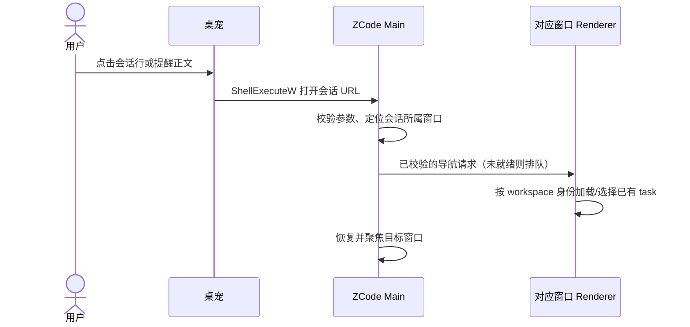

# 会话点击联动调查（2026-10-29）

本文件保留最初调查和长期方案。现已按方案一实现原生 UIA 桥接：会话行和提醒正文共享导航服务，具体规则以 [behavior.md](behavior.md) 的“会话导航”为准。桌宠继续只读观察数据，不修改官方 ZCode 安装、数据库或配置，不开启调试端口。

## 已验证

- 当前桌宠实现已提交为 `69a0968`，包含原生浮层、材质、状态、提醒、避让和刷新率驱动的动画。
- Windows UI Automation 能读取运行中的 ZCode。AX 树包含项目分组、会话列表项、完整标题和当前页面标题。
- 实际通过 AX 列表项点击，在两个既有会话间切换成功，并以页面标题变化确认；验收后恢复原会话。未发送消息、启动任务或修改会话内容。
- 本次 AX 快照中，会话列表项没有暴露稳定的 session/task ID；条目名称包含动态时间，不能把整条 Name 当固定键。
- 本地 ZCode 源码 `packages/ui/src/TaskListItem.tsx:539` 起：列表项是可聚焦的 `li`，支持点击及 Enter/Space。身份在 `data-testid` / `data-task-item-key` 中，没有对应的 HTML `id`。不能假设 DOM 的 data 属性自动成为 UIA AutomationId。
- 本机已注册 `zcode` URL 协议。当前本地源码 `packages/desktop/src/main/desktopDeepLinkUrl.ts` 和 `desktopOAuthDeepLink.ts` 提供工作区、OAuth、支付、分享入口，没有打开指定会话的入口。源码与安装版可能存在版本差异，本调查没有逐字比较安装包，也未调用猜测的会话 URL。
- ZCode 已有内部通知跳转：`desktopNotifications.ts:137` 的点击处理聚焦发出通知的窗口，并发送 `TaskNotificationClick`；`packages/ui/src/root/useRootPlatformEffects.ts:248` 查找 task 所属 workspace，激活 tab 并设置 activeTaskId。它是 Electron 内部 IPC，不是外部程序可以直接调用的接口。当前处理依赖窗口中已有的 workspace/task 缓存，也不能直接当作完整的跨窗口路由。

没有提交 AX 全量内容、真实会话标题或用户会话 ID。

## 方案一：兼容现有官方版，原生 UIA 桥接

桌宠的行点击与提醒正文点击共用一个导航入口。传入捕获的 workspace/session 身份和完整标题；提醒绑定事件发生时的 Session，不能按当前行号或最新通知反查。关闭钮只关闭提醒，正文跳转后提醒仍保留。

1. 仅响应用户主动点击，在 UIA 专用工作线程中解析 ZCode 窗口及其会话侧栏，避免阻塞浮层动画。
2. 使用项目分组和精确标题匹配，忽略独立的时间文本。要求候选唯一；重名、项目名歧义、折叠/筛选后不可见时返回明确的未定位结果，不选择第一个近似匹配。
3. 优先检查 Invoke/SelectionItem/LegacyIAccessible 等实际可用的模式；本次仅验证了 AX 定位加点击，尚未确认该 `li` 支持哪个原生动作模式。必要时可聚焦条目再发送 Enter，必须先确认焦点归属。不要模拟固定屏幕坐标。
4. 仅在用户点击时恢复/聚焦目标窗口；后台轮询不抢焦点。导航结果异步回到桌宠。避免重复点击并发，也不在导航失败后自动启动新的 ZCode 或新会话。
5. 页面标题变化可以作为基本成功反馈，但重名情况下不足以证明 session 身份，因此本方案不能承诺任意会话精确跳转。

适合先完成可见、唯一会话的联动。折叠、搜索、多窗口、重名、语言切换、会话改名都需要单独验收。系统 COM UIA 可直接集成到当前 C++ 程序，无需分发 Node/Python 自动化运行时。

## 方案二：按身份准确跳转，新增 ZCode 会话深链

建议扩展现有协议，例如 `zcode://session/open?workspace=...&taskId=...`。这是拟议接口，当前不可用；参数应统一编码，远端需保留 workspaceIdentity 和连接归属，不能只按本地 path 匹配。

Main 只负责协议校验、窗口路由及投递；Renderer/现有 session owner 负责 workspace/task 选择。应抽取复用内部通知的选择逻辑，但补齐缓存未加载、窗口归属、就绪排队和失败反馈；不能从 Main 直接写业务状态。拒绝未知/删除会话，不自动创建任务或隐式信任并打开任意目录。

桌宠侧只需共享导航入口、行命中测试和提醒的身份持有。ZCode 侧需先明确导航契约并补测试；不会因本调查而修改另一个仓库或替换用户安装版。

## 建议

现有官方版先用 UIA 验证有限范围的交互；若产品要求任意会话、重名及多窗口均可靠，则以会话深链作为长期入口。不要把内部 Electron IPC、DOM 属性或某次 AX 元素索引当作稳定对外 API。

## UIA 实现验收

- 导航位于 `src/session_navigation.cpp` 的专用 MTA 线程；只在用户点击时扫描已运行的 ZCode 窗口，不持续轮询 UIA。配置连接/事务超时，串行接收一次导航，COM 对象仅在线程内创建、使用及释放。
- 使用完整标题查找可聚焦的列表项，排除普通正文 li；在保留 Chromium 容器的 Raw View 中查找邻近项目标题分支，允许标题嵌套一层，不从包含另一会话列表的分支借用项目名。候选跨窗口去重后必须唯一。
- 鼠标按下捕获身份、抬起核对当前命中；提醒捕获自己的 session 身份，按最新观察解析现有标题。空标题、已离开列表或观察结果中的同项目名/标题歧义在触发 UIA 前拒绝。
- 本机实际点击桌宠第二行后，ZCode 标题切换到对应既有会话。实际点击绑定第一行的导航预览提醒后，ZCode 回到对应会话；提醒继续显示。两次均唯一匹配，并使用原生 Invoke（无键盘回退）。没有发送消息或创建任务。
- 本机对宠物完全透明角落右键成功打开工具栏，角色逐帧外轮廓不再决定交互区。自动化测试检查最低 alpha 填充及非透明像素保持原值。
- 未逐一验收不同 ZCode 版本、多窗口、最小化、权限等级不一致及所有回退动作；这些场景可能明确失败。UIA 动作返回成功只表示动作已提交，不承诺页面异步加载已经完成。

参考：[Microsoft UIA 元素查找](https://learn.microsoft.com/en-us/windows/win32/winauto/uiauto-obtainingelements)、[UIA 控件模式](https://learn.microsoft.com/en-us/windows/win32/winauto/uiauto-controlpatternsoverview)。

## 合并名称兼容

UIA 侧栏行名称可为完整标题加时间（如“字节2662分”）。保留完整标题精确匹配，额外接受明确的时间后缀；不删除标题内部空格，也不接受任意字符串前缀。使用点击时同项目的已知会话名称排除更长前缀候选，标题重名、跨窗口重复仍拒绝歧义。激活前重新验证名称与项目。已知列表不是应用的全部历史，未观察到的标题仍可能导致无法完全判断；不以模糊匹配强行导航。

## 0.2.4 项目显示名

按任务的 workspace_key + task_id 关联 tasks.project_id，再读取未删除 projects.name，与侧栏项目分组名精确比较，不再从当前工作目录推导现代项目名称。每轮观察刷新名称，点击时使用最新快照，目录名不同、工作树目录和同根目录下的不同项目均不会覆盖显式 project_id 归属。已知显示名重名时拒绝导航。

已识别现代项目表但关联缺失、项目删除、读取失败或无项目归属时，不猜目录名，导航不可用。只有确认数据库缺少该项目模型的旧格式，才保留原目录标签兼容。仍保留标题/时间后缀消歧与离屏提示，不修改 ZCode 的项目、数据库或侧栏。
